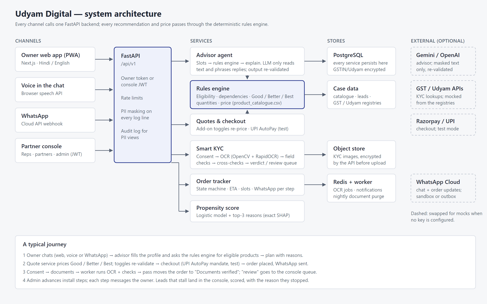

# Udyam Digital

**Connect a small business in one sitting, from the owner's phone.**

Udyam Digital is a mobile-first web app, plus a WhatsApp channel, for buying business connectivity in India. A shop, clinic or workshop owner chats with an AI advisor in English, Hindi or Hinglish. They get one monthly price for an eligible plan and can change it without starting over. They photograph their documents and have them checked while they wait, then track the install on WhatsApp. A partner console serves the field reps and partners who handle the leads that need a person.

Built by Team Stack Overflow for the Accel YTL Hackathon, Track A (Project Udyam Digital). The case data in [`data/`](data/) is used as given; every business and document in it is synthetic.

[](https://github.com/lucifer4330k/Airtel-Sync/actions/workflows/ci.yml)

**Contents:** [The problem](#the-problem) · [The solution](#the-solution) · [Features](#features) · [Measured results](#measured-results) · [Tech stack](#tech-stack) · [Repository layout](#repository-layout) · [Run it locally](#run-it-locally) · [Try the journey](#try-the-journey) · [Tests](#tests) · [Deploy for free](#deploy-for-free) · [API](#api) · [Key decisions](#key-decisions) · [Docs](#docs) · [System architecture](#system-architecture)

---

## The problem

The case data covers 5,000 small-business leads from April to June 2026, sold through field sales:

| | |
| --- | --- |
| Leads that became working customers | **368 of 5,000 (7.4%)** |
| Days from first contact to a working connection | **17.6** on average |
| Times the owner chased for an update | **3** on average |
| Sales cost per connected business | **₹15,053** |

Where the 4,632 lost leads stopped, and why (from `smb_leads.csv`):

| Stage reached | Leads | Lost here | Main reasons recorded |
| --- | ---: | ---: | --- |
| Asked to be contacted | 5,000 | 1,594 | unreachable after 3 calls (805), not interested on the first call (470), wrong number (319) |
| Reached by phone | 3,406 | 1,432 | **no time for a sales visit (531)**, locked in with their provider (325), **visit never scheduled (296)**, only wanted a mobile plan (280) |
| Needs assessed | 1,974 | 1,113 | price too high (414), competitor cheaper (207), **quote too complex (206)**, **quote took too long (179)**, decided to wait (107) |
| Quote accepted | 861 | 273 | **missing GST or Udyam document (94)**, **paperwork too long (79)**, **signatory not available (53)**, **details didn't match (47)** |
| Documents complete | 588 | 220 | **install delayed past 21 days (98)**, cancelled before install (53), site not feasible (41), **first payment failed (28)** |
| Connected and working | 368 | | |

**1,611 of those businesses (the reasons in bold) didn't leave over the product.** They left over a visit, a wait or paperwork, and those steps can move onto the owner's phone.

## The solution

Each step of the old journey that lost businesses is replaced by something the owner does alone, in one sitting:

| The owner, on the phone | Replaces | Lost to the old step |
| --- | --- | ---: |
| Describes the business in their own words, typed or spoken. At most six questions; the GSTIN is checked against the registry. | Waiting for a sales visit | 827 |
| Sees one monthly price and can change the budget or needs; the plan is repaired on the spot. | Waiting days for a quote | 385 |
| Approves UPI AutoPay; the order and its expected activation date are created at once. | Paying after the visit | 28 |
| Photographs four documents, checked against the registries and each other while they wait. | Handing over paperwork in person | 273 |
| Follows the install on WhatsApp and moves the engineer visit from a link. | Calling to ask where the order is | 98 |

Leads that genuinely need a person, such as a site survey for a leased line or an owner who asks for a call, go to the partner console, ranked by how likely they are to activate.

## Features

### Owner app (`/start`)

**AI advisor** (`/chat`)
- Chat in English, Hindi or Hinglish, typed or spoken (browser speech recognition), with replies read aloud on request.
- Asks at most six questions. A deterministic controller fills the slots (business type, staff, sites, city, GSTIN, needs, budget) and asks only what it can't look up.
- The GSTIN and Udyam number are verified against the mock government registries, and the business details are filled in from them.
- Products are chosen by the rules engine, never by the language model. The LLM (Gemini or OpenAI through LangChain, optional) only reads free text and phrases replies, and its output is re-validated. With no API key the advisor runs fully offline on its rule-based extractor.
- Ineligible asks get the nearest eligible option with the reason. Site surveys and "call me" requests are flagged for a person, with the chat attached.

**Rules engine and pricing**
- Eligibility per product: city tier, minimum staff, minimum sites, and an active GSTIN where required, all from `product_catalogue.csv`.
- Dependencies: add-ons that need a base connection always get one, and a second primary connection is never stacked.
- Essential, Recommended and Complete tiers per segment, built from the 368 bundles that actually activated.
- Prices sit at about 45% of each product's catalogue range, where real deals landed, sliding toward the minimum at 5+ and 10+ units. Quantities scale with staff and sites.

**Quote and checkout** (`/quote`, `/checkout`)
- One monthly price, all-in, with setup fees and contract length shown.
- Add-on switches re-price and re-validate on the server. A blocked switch gives a one-line reason.
- Share link and print-to-PDF.
- Mobile number plus UPI AutoPay or Razorpay in test mode; placing the order sets the expected activation date from install times and sends the first WhatsApp update.

**Quote repair: "What if my budget or needs change?"**
- The owner can set a budget, mark services as essential, add or remove services, change the number of sites or the city, lose GST registration, or switch connection.
- The engine names what broke and the rule behind it (city tier, minimum staff, needs active GST, needs a base connection, budget).
- It returns the smallest valid fix, a clear trade-off when not everything fits ("keep your essentials" vs "stay within budget"), or a specialist handoff that keeps the unmet need on file.
- A budget fix may downgrade the connection but never removes it, and every option is re-checked by the rules engine before it is shown.

**Smart KYC** (`/kyc`)
- Consent first. Withdrawing consent deletes the documents.
- GSTIN and Udyam lookups fill in the business identity before any upload.
- Four documents: GST certificate, Udyam certificate, signatory ID and address proof. For each upload:
  - **File type:** checked from the bytes, not the file name.
  - **Clean-up:** watermarks are removed, tilted photos are straightened from the text angle, and blurred photos are rejected with a clear message.
  - **Reading:** OCR runs offline with OpenCV and RapidOCR, then the fields are extracted. GSTIN digit/letter confusions (0 vs O) are corrected by position and verified with the checksum.
  - **Checks:** against the registry (status Active, legal name, GSTIN), against the other documents (same business, authorised signatory), and the case rules (address proof at most 90 days old).
- Every problem is explained in plain words, for example "The bill is dated 31 Oct 2025, 257 days old. Upload one from the last 90 days."
- The verdict is pass, fail, review or incomplete. "Review" goes to a person in the console. A pass moves the order forward by itself.
- Images are encrypted before storage and deleted after verification by the purge job.

**Order tracker** (`/track/<order>`)
- State machine: order placed → documents verified → engineer visit booked → installed → working, plus on hold (always with a reason).
- Expected activation date from the first minute, and reschedulable engineer visit slots.
- A WhatsApp message on every change, with a link back to the tracker.

### WhatsApp channel
- Meta Cloud API webhook into the same advisor, so a chat can start on WhatsApp.
- Replies link to the plan in the web app; documents are never collected in chat.
- Inbound posts are verified with the `X-Hub-Signature-256` HMAC and refused if unsigned (unless explicitly allowed for a local demo).

### Partner console (`/console`)
- JWT login with rep, partner and admin roles, scoped to their city or territory.
- **Leads:** ranked by likelihood to activate, each with its top three reasons, where the journey stopped and why, and the chat transcript. Assign leads and log follow-ups.
- **Funnel:** stage counts, conversion and cost per activation by source, and the top drop reasons.
- **KYC review queue:** the checks a machine shouldn't decide alone, approved or rejected with a note.
- **Orders:** advance installs, put orders on hold with a reason, and see every WhatsApp message sent (outbox).
- **Audit log** of every staff view and action.

### Lead likelihood score
- Built only from what is known when the lead arrives; the 16 fields that leak the outcome are excluded.
- Logistic regression is served (ROC-AUC 0.669 on held-out data vs 0.624 for LightGBM), so each score comes with exact per-feature contributions as its reasons.

### Judge challenge (`/judge`)
- Pick one of five preset businesses (clinic, kirana, restaurant chain, textile unit, small office) or set your own profile.
- See its quote tiers and a table of all 25 products with the rule that allows or blocks each one.
- Break the quote: change the budget, sites, city, GST, staff or connection, add services, mark essentials. Each change shows the rule applied, the repair options, and an independent rules-engine re-check of every option.
- The measured scorecard and the K01–K12 KYC table sit underneath.

### Landing page (`/`)
- Tells the story from the case data: the problem, a 3D funnel of the 5,000 leads with the drop reasons at each stage, the old steps the app replaces, each feature with a real example, the test scorecard, sample documents and the architecture.
- The 3D pieces (the funnel boxes and the "exploded" phone in the hero) are plain CSS transforms, with no WebGL. Reduced-motion settings show the final state.
- A live API status indicator shows when the free host is waking up.

### Security and privacy
- **Logs:** identifiers (GSTIN, Udyam, phone, PAN, Aadhaar-like numbers) are masked in every log line, including access logs and tracebacks, and capability tokens are redacted from URLs.
- **Encryption:** GSTIN and Udyam columns are encrypted with Fernet, and documents are encrypted by the API before they reach storage.
- **Owner access:** signed capability tokens; an id alone returns 404. Staff access is role-scoped with an audit trail.
- **Abuse limits:** per-route rate limits on the advisor, KYC, login, judge and webhook.
- **Production guard:** in `ENVIRONMENT=production` the API refuses to start with weak or missing secrets.
- **Language:** English and Hindi throughout the owner app (next-intl), with Devanagari and Tamil fonts loaded.

## Measured results

From [`scripts/scorecard.py`](scripts/scorecard.py), written to `apps/api/app/services/scorecard.json` and shown on `/judge`. Re-run it after changing the rules.

| Test | Result |
| --- | --- |
| Plans built for all 5,000 lead profiles (every tier) | **14,937 plans, 0 with an ineligible product, 0 broken dependencies** |
| Advisor personas (kirana without GST, 3-site restaurant chain, clinic asking for a leased line, Hindi and Hinglish speakers, cancelled and mistyped GSTINs…) | **27 of 27** get the right plan, in 5 turns or fewer |
| Quote repair on 1,000 random leads with random budget, site, city and service changes | **564 of 564** solvable cases fixed within budget (keeping a connection), **0 invalid options** |
| Smart KYC on the 12 specimen applicants (47 images) | **12 of 12** correct verdicts with the right reason |
| Lead likelihood score on held-out leads | **ROC-AUC 0.669** |

## Tech stack

| Layer | Technology |
| --- | --- |
| Web app | Next.js 14 (App Router), TypeScript, Tailwind CSS, next-intl, lucide-react, Recharts |
| API | Python 3.11+, FastAPI, Pydantic v2, SQLAlchemy 2, Alembic |
| Database | PostgreSQL 16 |
| Queue (optional) | Redis + RQ worker for OCR; inline background tasks otherwise |
| OCR | OpenCV + RapidOCR (ONNX), fully offline |
| AI (optional) | LangChain with Gemini or OpenAI; offline rules without a key |
| ML | scikit-learn (logistic regression), LightGBM for comparison |
| Object storage | Local disk or S3-compatible (SeaweedFS in Docker Compose), encrypted by the API |
| Messaging and payments | WhatsApp Cloud API, Razorpay (test mode) |
| Tests | pytest, Ruff, ESLint, Playwright |
| Hosting (free) | Vercel (web), Hugging Face Spaces Docker (API), Neon (Postgres) |

## Repository layout

```
.
├── apps/
│   ├── api/                     FastAPI backend
│   │   ├── app/
│   │   │   ├── core/            config, logging and masking, security, rate limits
│   │   │   ├── models/          SQLAlchemy models (encrypted columns)
│   │   │   ├── routers/         advisor, quotes, kyc, orders, console, judge, whatsapp, mock registries
│   │   │   ├── services/        rules engine, pricing, quotes, repair, advisor/, kyc/, tracker, propensity
│   │   │   ├── workers/         document purge
│   │   │   ├── bootstrap.py     migrate and seed on first boot
│   │   │   └── main.py
│   │   ├── alembic/             database migrations
│   │   ├── tests/               unit, API, personas, KYC answer key
│   │   ├── Dockerfile
│   │   └── start.sh
│   └── web/                     Next.js app
│       ├── app/(site)/          landing page and judge challenge
│       ├── app/(owner)/         start, chat, quote, checkout, kyc, track
│       ├── app/(console)/       partner console
│       ├── components/          UI, KYC, what-if, landing 3D pieces
│       ├── messages/            en.json, hi.json
│       └── e2e/                 Playwright tests
├── data/                        case data: leads, catalogue, mock registries, 47 KYC images
├── ml/                          propensity model training and report
├── scripts/                     seed_db.py, scorecard.py
├── deploy/                      Hugging Face Space deploy script and env template
├── docs/                        architecture, privacy note, KYC answer key, demo script, presentation
├── infra/                       SeaweedFS S3 config
├── docker-compose.yml
├── DEPLOY.md
└── render.yaml
```

## Run it locally

### Prerequisites

- [Docker](https://www.docker.com/) (for Postgres and Redis, or the whole stack)
- [uv](https://docs.astral.sh/uv/) for Python 3.11+
- Node.js 22 and npm

### Option A: everything in Docker

1. Create the env file and set a Fernet key for `FIELD_ENCRYPTION_KEY`:

   ```bash
   cp .env.example .env
   python -c "from cryptography.fernet import Fernet; print(Fernet.generate_key().decode())"
   ```

   Paste the printed key into `.env`, and set `JWT_SECRET` to a long random string.

2. Build and start Postgres, Redis, the SeaweedFS object store, the API, the OCR worker and the web app:

   ```bash
   docker compose up --build
   ```

3. Open http://localhost:3000. The API reference is at http://localhost:8000/docs.

### Option B: run the API and web app yourself (best for development)

1. Create `.env` as in step 1 above.

2. Start Postgres and Redis:

   ```bash
   docker compose up -d postgres redis
   ```

3. Install, migrate, seed and run the API:

   ```bash
   cd apps/api
   uv sync --extra dev
   uv run alembic upgrade head
   uv run python ../../scripts/seed_db.py
   uv run uvicorn app.main:app --reload --port 8000
   ```

   The seed loads the 5,000 leads, the catalogue and the console team. It prints a demo order's tracker link and the console logins: `admin`, `rep.pune`, `partner.mumbai` and `partner.delhi`. The password is `CONSOLE_DEMO_PASSWORD`, which defaults to `udyam-demo`.

4. In a second terminal, run the web app:

   ```bash
   cd apps/web
   npm install
   npm run dev
   ```

5. Open http://localhost:3000 for the landing page. The owner app is at `/start`, the console at `/console` and the judge challenge at `/judge`.

### Configuration

All settings live in `.env`; [`.env.example`](.env.example) documents each one. The ones that matter most:

| Variable | What it does |
| --- | --- |
| `DATABASE_URL` | Postgres connection (`postgresql+psycopg://…`) |
| `FIELD_ENCRYPTION_KEY` | Fernet key for encrypted columns and documents (required) |
| `JWT_SECRET` | Signs owner links and console sessions |
| `REFERENCE_DATE` | "Today" for date rules, `2026-07-15` per the case |
| `GOOGLE_API_KEY` / `OPENAI_API_KEY` | Optional LLM for warmer phrasing; leave empty to run offline |
| `STORAGE_BACKEND` | `local` (writes to `.storage/`) or `s3` |
| `KYC_QUEUE` | `inline` (OCR in the API) or `rq` (Redis worker) |
| `CONSOLE_DEMO_PASSWORD` | Password for the seeded console accounts |
| `NEXT_PUBLIC_API_URL` | Where the web app finds the API |

**On Windows**, keep `127.0.0.1` rather than `localhost` in the service URLs in `.env`. `localhost` tries IPv6 first, and Docker's port mapping stalls about 50 seconds per connection.

## Try the journey

1. Open the advisor at `/chat` and describe a business, for example: *"Furniture workshop in Nagpur, 12 workers, GSTIN 27XUIXG0767D1ZP, need email"*.
2. Open the plan, switch an add-on, and try "What if my budget or needs change?" with a lower budget.
3. Pay in test mode with any 10-digit mobile number.
4. Give consent and upload the four documents that pass from `apps/web/public/samples/` (also downloadable from the landing page). The order moves to "Documents verified". Upload `old-address-proof.png` instead to see it caught as 257 days old.
5. Sign in to `/console` as `admin` and advance the install. The tracker updates by itself, and the WhatsApp message appears in the outbox.
6. Open `/judge`, pick a business and try to break its quote.

The full 3-minute walkthrough is in [docs/demo-script.md](docs/demo-script.md).

## Tests

```bash
cd apps/api && uv run pytest -q && uv run ruff check .
cd apps/web && npm run lint && npx tsc --noEmit && npm run e2e
```

- **Advisor personas** (`tests/advisor_scenarios/personas.yaml`): 27 personas, each listing what must be in the plan and what must never appear. Every quote is re-checked against the rules engine.
- **No ineligible product, ever** (`tests/unit/test_pricing.py`): all 5,000 lead profiles through the plan builder.
- **KYC answer key** (`tests/kyc_answer_key/`): K01–K12 through the full pipeline, each with the expected verdict and reason. See [docs/kyc-answer-key.md](docs/kyc-answer-key.md).
- **Quote repair** (`tests/unit/test_repair.py`): budget gap, essentials that don't fit, AirFiber that can't carry backup, GST lapse, tier change, never removing the only connection, plus a fuzz test over 300 random leads and changes.
- **API and security** (`tests/test_*.py`): quotes and orders, KYC, tracker, console scoping, what-if and judge endpoints, WhatsApp signature, purge, rate limits, log masking.
- **End to end** (`apps/web/e2e/`, Playwright on a phone viewport): the landing page into the owner app; chat → quote → add-on → checkout → consent → 4 uploads → tracker; the owner's what-if; and the judge breaking a quote.
- **Scorecard** (`scripts/scorecard.py`): the numbers in [Measured results](#measured-results).
- **CI:** every push runs the API tests against Postgres and the web lint and build. A nightly workflow reruns the personas with the real LLM and the end-to-end journey.

## Deploy for free

[DEPLOY.md](DEPLOY.md) walks through it in about 20 minutes, with no credit card needed:

| Part | Host |
| --- | --- |
| Web (Next.js) | Vercel (Hobby), root directory `apps/web` |
| API + OCR (Docker) | Hugging Face Spaces (Docker, CPU basic: 2 vCPU, 16 GB RAM), via `python deploy/hf_space.py` or the "Deploy API" GitHub Action |
| Postgres | Neon (free tier) |

On first boot the API migrates and seeds itself (`SEED_ON_START=true`). [`render.yaml`](render.yaml) is included for a paid Render setup with a separate worker.

## API

All routes are under `/api/v1`; the interactive reference is at `/docs`.

| Area | Endpoints |
| --- | --- |
| Meta | `GET /health` (database and LLM status), `GET /catalogue` |
| Advisor | `POST /advisor/sessions`, `POST /advisor/sessions/{id}/messages` |
| Quotes | `POST /quotes/preview`, `POST /quotes/price`, `POST /quotes`, `GET /quotes/{id}`, `PATCH /quotes/{id}/items`, `POST /quotes/{id}/accept` |
| Quote repair | `POST /quotes/{id}/what-if` (options only, changes nothing), `POST /quotes/{id}/what-if/apply` |
| Judge | `GET /judge/scenarios`, `POST /judge/plan`, `POST /judge/challenge`, `GET /judge/scorecard` |
| KYC | `POST /kyc/consent`, `POST /kyc/{business}/consent/withdraw`, `GET /kyc/lookup`, `PUT /kyc/{business}/identity`, `POST /kyc/documents`, `GET /kyc/{business}/status` |
| Orders | `GET /orders`, `GET /orders/{id}`, `POST /orders/{id}/reschedule` |
| Console | `POST /console/login`, leads (list, detail, assign, follow-ups), `GET /console/funnel`, KYC queue and resolve, orders (advance, hold), notifications, audit |
| WhatsApp | `GET` and `POST /whatsapp/webhook` |
| Mock registries | `GET /mock/gstin/{gstin}`, `GET /mock/udyam/{number}` |

Owner endpoints take the signed capability token from the quote or order link. Console endpoints take the JWT from `/console/login`.

## Key decisions

- **The LLM never decides eligibility.** The rules engine does, and quotes are re-validated on every change and again at checkout.
- **The demo never depends on a network call.** Without an LLM key the advisor runs on its own rules, OCR runs offline, and the government registries are mocked from the case data.
- **Repair before restart.** A changed budget or need repairs the existing plan instead of sending the owner back to the start.
- **Identifiers are masked in every log line, encrypted in the database, and documents are encrypted before storage.**
- **Owner access uses signed capability tokens** until OTP login lands.
- **"Today" is 2026-07-15** for date rules (`REFERENCE_DATE`), per the case README.
- **Every number on the landing page comes from the case data or a re-runnable test,** and the plan and repair examples shown are real rules-engine output.
- **SeaweedFS replaces MinIO** in Docker Compose, since MinIO no longer publishes community images; encryption doesn't depend on the store.

## Docs

- [Deploy guide](DEPLOY.md)
- [Privacy and security note](docs/privacy-note.md) (1 page)
- [KYC answer key](docs/kyc-answer-key.md)
- [3-minute demo script](docs/demo-script.md)
- [Presentation](docs/presentation/) (PDF and PPTX)
- [Architecture diagram source](docs/architecture.svg)

### Still to do

- OTP login for owners (capability tokens stand in for now).
- Marathi and Tamil copy, after a native-speaker pass.

## System architecture



Every channel (the owner app with voice input, WhatsApp, and the partner console) calls one FastAPI backend. Inside it, the advisor, quotes, quote repair, Smart KYC, order tracker and propensity score all pass through the deterministic rules engine for anything that decides what a business can buy and at what price. Postgres holds the case data, leads, quotes, orders and check results; documents go encrypted to the object store, and OCR can run in the API or on a Redis-backed worker. The LLM, the registry APIs, Razorpay and WhatsApp sit at the edge, and every one of them is optional or mocked, so the whole journey runs offline.
